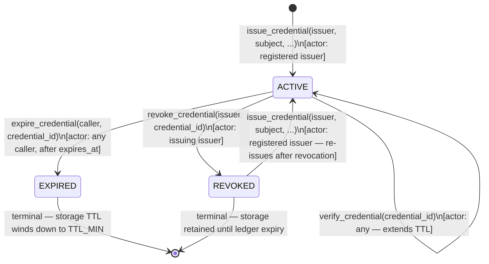
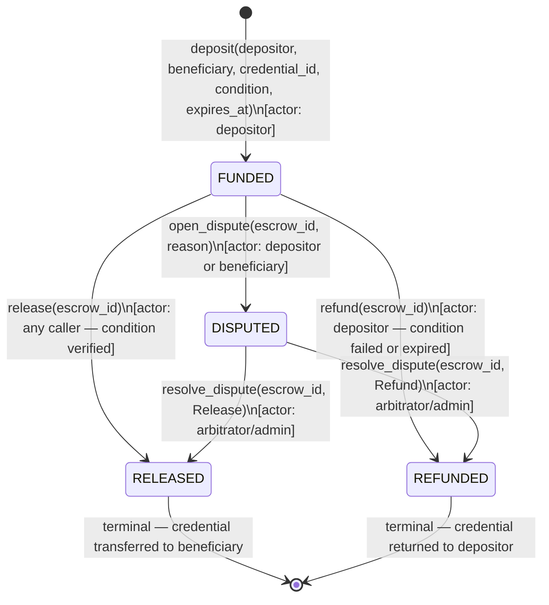
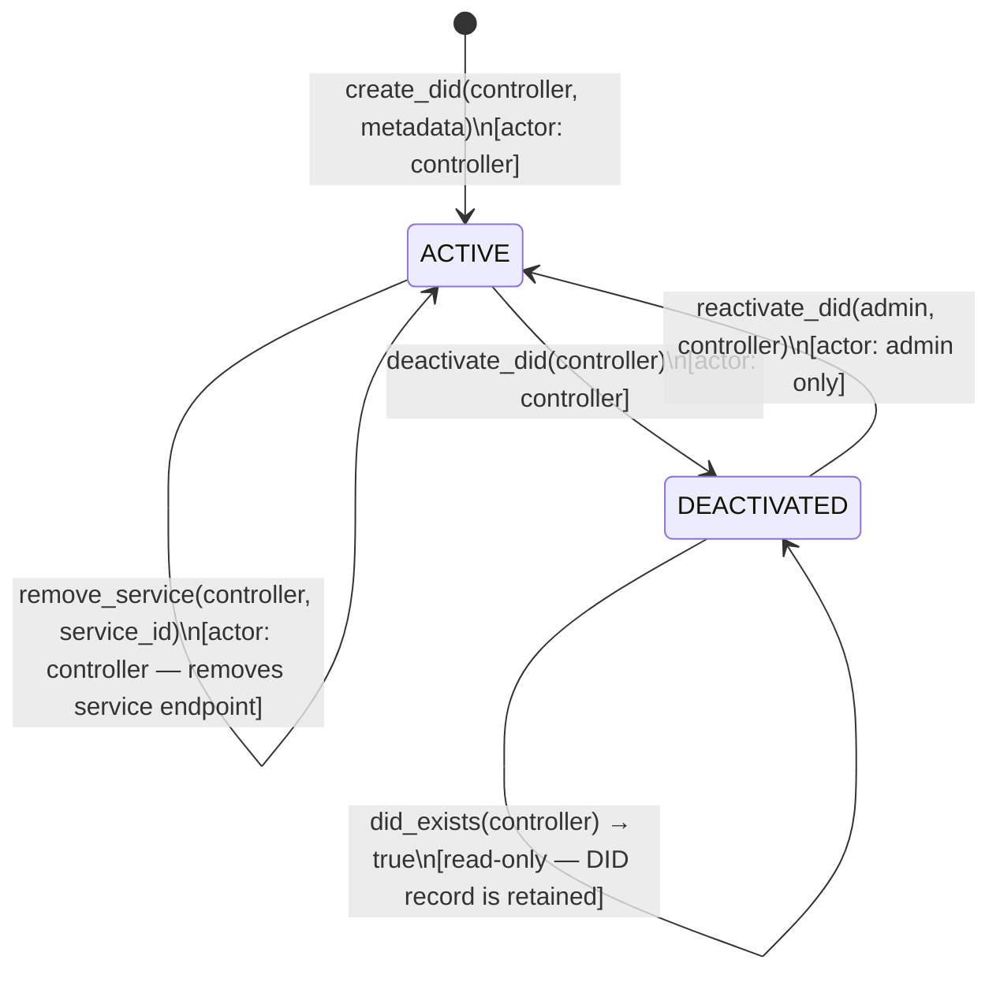

# Architecture

> Design decisions behind this architecture are recorded in [ADRs](adr/README.md).

## Overview

Soroban Identity is composed of three layers:

```
┌─────────────────────────────────────────┐
│              dApps / Frontend           │
├─────────────────────────────────────────┤
│           TypeScript SDK                │
│   IdentityClient  |  CredentialClient   │
├──────────────────┬──────────────────────┤
│ identity-registry│  credential-manager  │  ← Soroban contracts
└──────────────────┴──────────────────────┘
         Stellar Network (Soroban)
```

## Contracts

### identity-registry

Manages DID documents on-chain.

| Function | Description |
|---|---|
| `initialize(admin)` | One-time setup |
| `propose_admin(current_admin, proposed_admin)` | Step 1: propose a new admin (current admin only) |
| `accept_admin(new_admin)` | Step 2: accept a pending admin proposal (proposed admin only) |
| `create_did(controller, metadata)` | Mint a new DID |
| `update_did(controller, metadata)` | Update metadata |
| `deactivate_did(controller)` | Soft-delete a DID |
| `resolve_did(controller)` | Read a DID document |
| `has_active_did(controller)` | Boolean check |

### credential-manager

Issues and verifies verifiable credentials. A maximum of **100 issuers** (`MAX_ISSUERS`) can be registered at any time by default; `add_issuer` returns `MaxIssuersReached` if the cap is hit. The admin can raise or lower this cap via `set_max_issuers`, up to a hard ceiling of **500 issuers** (`ABSOLUTE_MAX_ISSUERS`).

It also hosts the **credential escrow service**, which holds credentials (or the
assets backing them) in a conditional-hold state until a release condition is
satisfied, a dispute is resolved, or the escrow is refunded.

| Function | Description |
|---|---|
| `initialize(admin)` | One-time setup |
| `transfer_admin(current_admin, new_admin)` | Transfer admin rights (current admin only) |
| `add_issuer(issuer)` | Register a trusted issuer (admin) |
| `remove_issuer(issuer)` | Remove an issuer (admin) |
| `set_max_issuers(admin, new_max)` | Raise or lower the issuer cap, up to `ABSOLUTE_MAX_ISSUERS` (admin) |
| `issue_credential(issuer, subject, type, claims, claims_hash, sig, expires)` | Issue a credential |
| `revoke_credential(issuer, id)` | Revoke a credential |
| `verify_credential(id)` | Check validity |
| `verify_claims_hash(id, hash)` | Verify off-chain claims hash matches stored hash |
| `get_credential(id)` | Fetch full credential |

### credential-escrow

Conditional release of credentials between a depositor and a beneficiary. The
depositor locks a credential (identified by its `credential_id`) together with a
release condition; funds or the credential are only released once the condition
verifies, or are refunded to the depositor if the condition fails or expires.

| Function | Description |
|---|---|
| `initialize(admin)` | One-time setup |
| `deposit(depositor, beneficiary, credential_id, condition, expires_at)` | Lock a credential in escrow and return the new `escrow_id` |
| `verify_condition(escrow_id)` | Evaluate the escrow's release condition against current state |
| `release(escrow_id)` | Release the escrowed credential to the beneficiary (only if the condition verifies) |
| `refund(escrow_id)` | Return the escrowed credential to the depositor (failed/expired condition) |
| `open_dispute(escrow_id, reason)` | Flag an escrow as disputed (depositor or beneficiary) |
| `resolve_dispute(escrow_id, resolution)` | Arbitrator/admin resolves a dispute, releasing or refunding |
| `get_escrow(escrow_id)` | Fetch full escrow record |
| `get_escrow_status(escrow_id)` | Fetch only the current escrow status |

#### Release conditions

An escrow's release condition is one of three variants, evaluated by
`verify_condition`:

| Condition | Description |
|---|---|
| `Time(deadline)` | Releases once the ledger timestamp is at or past `deadline` |
| `Payment(amount, asset, payer)` | Releases once the required payment from `payer` has been observed |
| `Approval(approver)` | Releases once `approver` has explicitly approved the release |

Conditions are evaluated on-chain by `verify_condition`; `release` re-runs the
same check and fails closed with `ConditionNotMet` if it does not hold. A
condition that can never be satisfied (e.g. a `Time` deadline that has passed
without release, or an approval that is rejected) makes the escrow eligible for
`refund`.

#### Dispute resolution

Either party may call `open_dispute` while an escrow is `FUNDED` or `DISPUTED`,
moving it to `DISPUTED` and freezing automatic release/refund. Only the
configured arbitrator (or the contract admin) may call `resolve_dispute`, which
either releases the credential to the beneficiary or refunds the depositor and
moves the escrow to its terminal state.

## DID Format

```
did:stellar:<bech32-stellar-address>
```

Example: `did:stellar:GABC...XYZ`

The identifier MUST match the following regular expression, where the address
segment is a 56-character Stellar public key (Ed25519, `G...`):

```
^did:stellar:G[A-Z2-7]{55}$
```

This is W3C DID-compatible and portable across any dApp that integrates the SDK.

## Credential Flow

```
Issuer                Subject               Verifier
  │                     │                      │
  │── issue_credential ─▶│                      │
  │                     │── present cred id ──▶│
  │                     │                      │── verify_credential
  │                     │                      │◀─ true / false
```

## Credential Lifecycle

Every credential moves through these states. All transitions are permanent except the implicit re-issuance path for a previously revoked credential.



**Notes:**
- `expires_at = 0` means the credential never expires; only `revoke_credential` can terminate it.
- `expire_credential` is a permissionless sweep — any address can call it once the ledger timestamp exceeds `expires_at`.
- Re-issuance after revocation creates a new credential with a fresh `issued_at`; the revoked record remains in storage.
- `verify_credential` is read-only but bumps the persistent-storage TTL to keep the record alive.

## Escrow Lifecycle

Every escrow moves through these states. `RELEASED` and `REFUNDED` are terminal.



**Notes:**
- `verify_condition` and `get_escrow_status` are read-only; they never mutate escrow state.
- `release` re-verifies the condition on-chain and fails closed with `ConditionNotMet` if it no longer holds.
- `refund` is only permitted when the condition has failed or `expires_at` has passed; otherwise it returns `ConditionStillMet`.
- `open_dispute` freezes automatic transitions until `resolve_dispute` is called by the arbitrator or admin.
- Escrow records are stored in `persistent` storage and their TTL is bumped on every read/write, mirroring credentials.

## DID Lifecycle

A DID document is owned by its `controller` (the Stellar wallet that created it). Only the admin can reactivate a deactivated DID.



**Notes:**
- `resolve_did` and `has_active_did` are read-only and only succeed on `ACTIVE` DIDs.
- `did_exists` returns `true` for both `ACTIVE` and `DEACTIVATED` states — it checks presence without deserialising the document.
- Deactivation decrements the active DID counter; reactivation increments it.
- Service endpoints (`add_service` / `remove_service`) are only permitted on `ACTIVE` DIDs; attempting either on a `DEACTIVATED` DID returns `DidDeactivated`.
- A controller address can only hold one DID. `create_did` returns `DidAlreadyExists` if a document already exists for the address.

## Cross-Contract Calls & Reentrancy (Issue #551)

Soroban's execution model prevents classic EVM-style reentrancy at the host
level, but a contract that performs a cross-contract call is still
vulnerable to unexpected state if the called contract were ever changed to
call back into the caller (or into another guarded function) before the
outer call completes.

**Current cross-contract call graph:**

```
credential-manager::issue_credential ──▶ identity-registry::has_active_did
```

This is the only cross-contract call in the codebase today.
`identity-registry::has_active_did` is a read-only storage lookup — it does
not call any other contract, so there is currently **no circular
invocation path**.

**Guard**: `credential-manager::issue_credential` acquires a `ReentrancyGuard`
(an `EXECUTING` flag in instance storage) immediately before invoking
`has_active_did`, and releases it via `Drop` on every normal exit path
(including early `?` returns). A re-entrant call into `issue_credential`
while that flag is set fails closed with `ContractError::ReentrantCall`
instead of proceeding against partially-applied state. This is
defense-in-depth for if a future change makes `has_active_did` (or a
function it delegates to) call back into `credential-manager`; the pattern
should be applied to any new function that performs a cross-contract call.

## Privacy

- Claims are stored on-chain as key-value pairs (public by default)
- For sensitive data, pass a SHA-256 hash of the off-chain claims payload as `claims_hash` to `issue_credential`; the raw claims can be stored off-chain (e.g. IPFS or encrypted storage) and verified on-chain with `verify_claims_hash(id, hash)`
- ZKP integration is planned for selective disclosure without revealing raw claims

## Contract Events

### identity-registry

| Event topic | Payload | Emitted by |
|---|---|---|
| `(IDENTITY, "created")` | `(controller: Address, timestamp: u64)` | `create_did` |
| `(IDENTITY, "updated")` | `(controller: Address, metadata_hash: BytesN<32>)` | `update_did` |
| `(IDENTITY, "deactivated")` | `(controller: Address, timestamp: u64)` | `deactivate_did` |

### credential-manager

| Event topic | Payload | Emitted by |
|---|---|---|
| `(CRED, "issued")` | `(id: BytesN<32>, subject: Address, issuer: Address, type: CredentialType)` | `issue_credential` |
| `(CRED, "revoked")` | `(id: BytesN<32>, issuer: Address)` | `revoke_credential` |

### credential-escrow

| Event topic | Payload | Emitted by |
|---|---|---|
| `(ESCROW, "deposited")` | `(escrow_id: BytesN<32>, depositor: Address, beneficiary: Address, credential_id: BytesN<32>)` | `deposit` |
| `(ESCROW, "condition_verified")` | `(escrow_id: BytesN<32>, condition: Condition)` | `verify_condition` |
| `(ESCROW, "released")` | `(escrow_id: BytesN<32>, beneficiary: Address)` | `release` / `resolve_dispute` |
| `(ESCROW, "refunded")` | `(escrow_id: BytesN<32>, depositor: Address)` | `refund` / `resolve_dispute` |
| `(ESCROW, "disputed")` | `(escrow_id: BytesN<32>, reason: Symbol)` | `open_dispute` |
| `(ESCROW, "dispute_resolved")` | `(escrow_id: BytesN<32>, resolution: Resolution)` | `resolve_dispute` |

## Storage

- `persistent` storage is used for DID documents, credentials, and escrow records (survives ledger expiry with TTL bumps)
- `instance` storage is used for admin, issuer registry, and escrow configuration (arbitrator address)

## Geo-Distributed Read Replicas

To serve global read traffic with low latency, the backend runs read
replicas in three regions alongside a single authoritative primary.

### Replication Topology

```
                    ┌──────────────────────────┐
                    │   Primary (write node)   │
                    │        us-east-1         │
                    └────────────┬─────────────┘
                                 │  async WAL / logical replication
        ┌────────────────────────┼────────────────────────┐
        │                        │                        │
        ▼                        ▼                        ▼
┌───────────────┐        ┌───────────────┐        ┌───────────────┐
│  Replica US   │        │  Replica EU   │        │ Replica Asia  │
│   us-west-2   │        │  eu-central-1 │        │ ap-southeast-1│
└───────────────┘        └───────────────┘        └───────────────┘
        ▲                        ▲                        ▲
        └──────────── nearest-replica routing ───────────┘
```

- **Primary** (`us-east-1`): the only node that accepts writes. All
  `create_did`, `update_did`, `deactivate_did`, `issue_credential`,
  `revoke_credential`, and admin operations are routed here.
- **Replicas** (`us-west-2`, `eu-central-1`, `ap-southeast-1`): read-only
  followers that stream changes from the primary asynchronously. They serve
  `resolve_did`, `has_active_did`, `get_credential`, `verify_credential`,
  and `verify_claims_hash`.
- Replication is **asynchronous**, so replicas may lag the primary by a small
  amount (typically tens to low hundreds of milliseconds).

### Read/Write Splitting

The backend exposes a single logical connection and splits traffic based on
the operation:

| Operation type | Target | Rationale |
|---|---|---|
| Writes (contract invocations that mutate state) | Primary | Only the primary can accept writes |
| Reads after a write in the same request/session | Primary | Read-your-writes consistency |
| Independent reads | Nearest healthy replica | Low latency, offloads the primary |

Rules:

1. Any request that performs a write is pinned to the primary for the
   remainder of that request/session, guaranteeing read-your-writes.
2. Read-only requests are routed to the nearest healthy replica based on the
   client's region.
3. If no replica is healthy, reads fall back to the primary.

### Replica Lag Monitoring

Each replica reports its replication lag (the difference between the
primary's last applied ledger/sequence and the replica's). The backend:

- Exposes lag per replica as a metric (`replica_lag_seconds{region=...}`).
- Marks a replica **unhealthy** when lag exceeds the configured threshold
  (`REPLICA_MAX_LAG_SECONDS`, default 5s) and stops routing reads to it.
- Alerts when any replica exceeds the threshold for a sustained period.

### Failover

- **Replica failure**: the replica is removed from the routing pool and its
  traffic is redistributed to the remaining healthy replicas, or to the
  primary if none remain. No writes are affected.
- **Primary failure**: writes fail over to the promoted primary; reads
  continue to be served by replicas (subject to lag) until promotion
  completes.
- Failover is automatic and health-check driven; a recovered replica is
  re-added to the pool only after it has caught up below the lag threshold.

### Eventual Consistency

Because replication is asynchronous, reads from a replica may not reflect a
just-committed write. The backend handles this as follows:

- **Read-your-writes**: after a write, the session is pinned to the primary
  (see Read/Write Splitting), so a client always observes its own writes.
- **Monotonic reads**: a session that has read from a replica is not moved
  to a replica that is further behind, avoiding time-travel on subsequent
  reads.
- **Lag-bounded reads**: replicas lagging beyond `REPLICA_MAX_LAG_SECONDS`
  are excluded from routing, bounding staleness for independent reads.
- **Consistency-sensitive reads**: callers that require the latest state can
  pass a `consistency: 'strong'` hint, which routes the read to the primary.

### Nearest-Replica Routing

The router selects a replica using, in order:

1. The client's region (from geo-IP or an explicit region hint).
2. The lowest-latency healthy replica within that region.
3. The nearest healthy replica in an adjacent region.
4. The primary, if no replica is healthy.

## Deployment

### Prerequisites

- [Stellar CLI](https://developers.stellar.org/docs/tools/developer-tools/cli/stellar-cli) installed
- Rust toolchain with `wasm32-unknown-unknown` target: `rustup target add wasm32-unknown-unknown`

### 1. Build Contracts

```bash
cargo build --target wasm32-unknown-unknown --release --manifest-path contracts/Cargo.toml
```

Compiled `.wasm` files will be in `contracts/target/wasm32-unknown-unknown/release/`.

### 2. Deploy to Testnet

```bash
# Deploy identity-registry
stellar contract deploy \
  --wasm contracts/target/wasm32-unknown-unknown/release/identity_registry.wasm \
  --source <SECRET_KEY> \
  --network testnet

# Deploy credential-manager
stellar contract deploy \
  --wasm contracts/target/wasm32-unknown-unknown/release/credential_manager.wasm \
  --source <SECRET_KEY> \
  --network testnet
```

Each command prints a contract ID — save these for the next step.

### 3. Initialize Contracts

```bash
# Initialize identity-registry
stellar contract invoke \
  --id <IDENTITY_REGISTRY_CONTRACT_ID> \
  --source <SECRET_KEY> \
  --network testnet \
  -- initialize \
  --admin <ADMIN_ADDRESS>

# Initialize credential-manager
stellar contract invoke \
  --id <CREDENTIAL_MANAGER_CONTRACT_ID> \
  --source <SECRET_KEY> \
  --network testnet \
  -- initialize \
  --admin <ADMIN_ADDRESS>
```

### 4. Deploy to Mainnet

Replace `--network testnet` with `--network mainnet` in all commands above. Mainnet requires funded accounts — use [Stellar Laboratory](https://laboratory.stellar.org) or an exchange to fund your deployer key.

```bash
stellar contract deploy \
  --wasm contracts/target/wasm32-unknown-unknown/release/identity_registry.wasm \
  --source <SECRET_KEY> \
  --network mainnet
```

### 5. Configure the SDK

Pass the deployed contract IDs to the SDK clients:

```typescript
import { IdentityClient } from '@soroban-identity/sdk';

const client = new IdentityClient({
  rpcUrl: 'https://soroban-testnet.stellar.org',       // or mainnet RPC
  networkPassphrase: 'Test SDF Network ; September 2015', // or mainnet passphrase
  identityRegistryId: '<IDENTITY_REGISTRY_CONTRACT_ID>',
  credentialManagerId: '<CREDENTIAL_MANAGER_CONTRACT_ID>',
});
```

### Reference

- [Stellar CLI docs](https://developers.stellar.org/docs/tools/developer-tools/cli/stellar-cli)
- [Soroban contract deployment guide](https://developers.stellar.org/docs/build/smart-contracts/getting-started/deploy-to-testnet)
